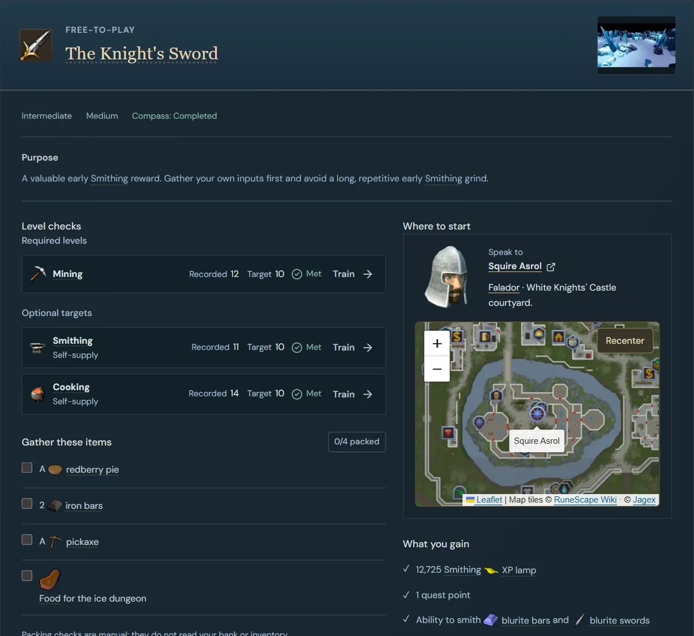

<div align="center">
  

# RS3 Compass

**RuneScape 3 quest preparation and skill planning for Ironman accounts.**

[Open the app](https://rs3-compass.mollard.deno.net/) · [Browse quests](https://rs3-compass.mollard.deno.net/quests) · [Explore skills](https://rs3-compass.mollard.deno.net/skills)

</div>



_Quest preparation with fictional sample-player data. Game artwork and maps: Jagex / RuneScape Wiki._

## What you can plan

| Workspace     | What it does                                                                                                                                                                                    |
| ------------- | ----------------------------------------------------------------------------------------------------------------------------------------------------------------------------------------------- |
| **Quests**    | Check levels, gather supplies, review combat risks and find the starting NPC on a map. Packing, notes and completion share one page.                                                            |
| **Skills**    | Browse all 29 skills in an in-game-style grid. Compare level ranges, training methods, creature/resource locations and Ironman benefits.                                                        |
| **Equipment** | Compare a training range's target kit with current-level alternatives. Use requirements and self-supply requirements stay separate: being able to equip mithril does not mean you can smith it. |
| **Players**   | Import public player data, switch between saved profiles and keep each player's plans separate. Removable fictional players let you explore without a lookup.                                   |

Switch between **F2P and Members** planning. The catalogue includes all 54 F2P quests and 9 miniquests/sagas, checked against November 2026 sources; Members quest coverage is selective. Seasonal quests and the tutorial remain available outside the regular progression route.

Compass prepares you to start an activity; it does **not** replace quest walkthroughs, the in-game journal or the [RuneScape Wiki](https://runescape.wiki/). Named items, skills, quests and locations link to their references, with Wiki artwork throughout the app.

## Public player data

Lookups use the official [RuneScape Platform APIs](https://developer.runescape.com/platform/), without a Jagex login or API key:

- **Hiscores:** recorded levels, XP, overall and skill ranks, and activity scores. Ranks are from the main RS3 Hiscores, not Ironman-only rankings.
- **Quest progress:** completed and started quests, reported eligibility, and authoritative quest-point totals. Eligibility is not a packing check.
- **Recent activity:** up to 20 published events, with linked references where a subject can be identified. Availability depends on active membership and the in-game RuneMetrics Event Log settings.

The Members planning toggle does not change an account's actual membership. Public data does not reveal your bank, inventory or owned equipment.

<details>
<summary>Refresh timing and unavailable data</summary>

Compass caches successful player lookups for 10 minutes and coalesces matching requests. Jagex also caches data, so delays can stack; quest progress may update after logout, a world hop or periodic synchronization.

If quests or activity become unavailable, Compass keeps the last successful snapshot and its original timestamp, labels it as stale, and preserves your local plans. A missing public snapshot is not treated as zero progress.

Artwork and map tiles use browser caching. Additional activity references are resolved in bounded, cached Wiki requests only when the activity view is opened.

</details>

## Your data stays in this browser

Notes, packing and plans are **local, not cloud-synced**. A functional cookie remembers the selected player name; public lookup responses are server-cached. Removing a saved profile does not change its RuneScape account.

Changing domains, browsers or devices does not carry your local workspace across. Export progress before moving or clearing site data. Wiki images, map tiles and activity-reference queries contact the RuneScape Wiki directly.

## Run locally

**Stack:** SvelteKit 3 · Svelte 5 · TypeScript · Tailwind CSS 4 · Leaflet · Deno Deploy with the Node adapter.

Requires **Node 22.12+ or 24 LTS**.

```sh
npm ci
npm run dev
```

Vite prints the local URL. To verify changes:

```sh
npm test
npm run build
```

The production build includes Svelte checks. Deno serves `build/index.js`; the stable deployment is **[rs3-compass.mollard.deno.net](https://rs3-compass.mollard.deno.net/)**. The player lookup requires a server and cannot run on GitHub Pages alone.

## Credits

Initial research drew on the [Ironbound guide](https://ironbound-rs3-alex.alexmollard93.chatgpt.site/guide/). Game artwork and map tiles come from the [RuneScape Wiki](https://runescape.wiki/) and belong to Jagex. Interface icons use [Lucide](https://lucide.dev/) (ISC).

RS3 Compass is an unofficial fan project, not affiliated with or endorsed by Jagex.
